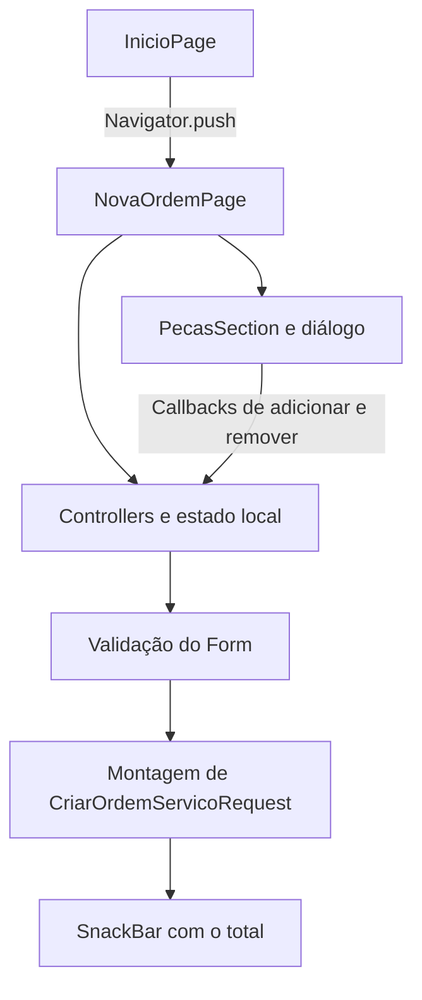
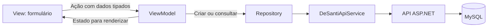

# Análise da arquitetura do frontend — DeSanti Automotiva

Data: **28/10/2026**.

> Registro histórico. A integração de 29/10/2026 implementou ViewModel,
> Repositories, HTTP e seleção de cliente. Consulte o estado atual em
> [README.md](README.md) e o guia [INTEGRACAO_OS.md](../backend/docs/INTEGRACAO_OS.md).

Este documento descreve o código encontrado no workspace, compara alternativas
consultadas em fontes primárias e propõe uma evolução para o ERP da oficina.
As propostas ainda não foram implementadas nem representam uma migração já
aprovada. Nenhum código do aplicativo foi alterado nesta análise.

## 1. Parecer

**A organização atual é uma boa base para o primeiro formulário, mas precisa
separar melhor as responsabilidades antes de receber a integração com a API e
novas telas.** Recomendo manter a organização por funcionalidade e evoluir para
**MVVM com repositórios e serviços**, em etapas pequenas.

Hoje há componentes de interface, um contrato de dados e estado local. Ainda
não existe MVVM completo, MVC formal ou Clean Architecture: validações,
cálculos e montagem do request estão no estado da página. A descrição mais
precisa é **frontend organizado por funcionalidade, com lógica concentrada
nos widgets**.

O melhor equilíbrio que identifico para a próxima fase é:

- Continuar agrupando Clientes e Ordens de Serviço em funcionalidades próprias.
- Separar apresentação, estado da tela, modelos e comunicação com a API.
- Preservar `StatefulWidget` para detalhes locais de interface.
- Começar a extração com um ViewModel simples, usando `ChangeNotifier` e
  dependências recebidas pelo construtor.
- Avaliar Riverpod quando dados e chamadas forem compartilhados entre telas.
- Acrescentar casos de uso quando houver complexidade ou repetição que os
  justifique.

Essa é uma avaliação aplicada ao tamanho atual, ao desenvolvimento manual no
VS Code e à evolução prevista do produto. Não existe uma arquitetura
universalmente superior para todo ERP.

O guia oficial do Flutter apresenta MVVM com Views, ViewModels, Repositories e
Services como referência adaptável a cada aplicação. A camada de domínio é
opcional. [Fonte: guia de arquitetura do Flutter](https://docs.flutter.dev/app-architecture/guide).

## 2. Escopo e limites da revisão

Foram lidos todos os oito arquivos Dart de produção em
`/home/diosec/Projects/DeSanti_Automotiva/frontend/lib`, o `pubspec.yaml`, as
configurações de análise e a documentação do projeto. O contrato de criação de
OS e o controller de Clientes foram consultados para verificar a fronteira com
o backend.

O ambiente tem Flutter **3.47.5** e Dart **3.13.4**. A dependência de produção
declarada é apenas o SDK Flutter; `flutter_test` e `flutter_lints` estão nas
dependências de desenvolvimento. Não há cliente HTTP ou biblioteca de estado
adicionados ao frontend.

Há alterações locais no backend, inclusive no contrato de OS. As observações
refletem os arquivos lidos nesta data, incluindo mudanças ainda não commitadas.
O [repasse de 05/10/2026](/home/diosec/Projects/DeSanti_Automotiva/REPASSE_THALLES.md)
é um registro anterior: a descrição de API padrão e ausência de Git já não
corresponde integralmente ao workspace atual.

Foi executado `flutter analyze`. Não foram executados o app, uma integração
real, testes do backend ou compilação Windows. Esta revisão não comprova
persistência, conectividade nem comportamento visual nos dispositivos.

## 3. Como o frontend está sendo feito

### Estrutura encontrada

Base: `/home/diosec/Projects/DeSanti_Automotiva/frontend/lib`.

```text
lib/
├── main.dart
├── theme/
│   └── app_theme.dart
├── shared/
│   └── formatters/
│       ├── brazillian_mask_formatter.dart
│       └── money_input_formatter.dart
└── features/
    └── ordens_servico/
        ├── nova_ordem_page.dart
        ├── pecas_section.dart
        └── criar_ordem_servico_request.dart
```

O nome `brazillian_mask_formatter.dart` reproduz a grafia atual do arquivo;
a classe nele se chama `BrazilianMaskFormatter`.

| Arquivo atual | Responsabilidade encontrada | Avaliação |
| --- | --- | --- |
| [main.dart](/home/diosec/Projects/DeSanti_Automotiva/frontend/lib/main.dart:1) | Inicialização, `MaterialApp`, tela inicial e navegação | Suficiente para duas telas; separar a tela inicial quando houver listagem real. |
| [app_theme.dart](/home/diosec/Projects/DeSanti_Automotiva/frontend/lib/theme/app_theme.dart:1) | Cores, temas claro/escuro e estilos de componentes | Boa separação, a preservar. |
| [nova_ordem_page.dart](/home/diosec/Projects/DeSanti_Automotiva/frontend/lib/features/ordens_servico/nova_ordem_page.dart:17) | Controllers, formulário, validações, lista de peças, totais, normalização e request | Principal concentração de responsabilidades; 330 linhas nesta revisão. |
| [pecas_section.dart](/home/diosec/Projects/DeSanti_Automotiva/frontend/lib/features/ordens_servico/pecas_section.dart:6) | Modelo `PecaItem`, lista, diálogo, validação e formatação monetária | A seção extraída ajuda; modelo e diálogo podem ter arquivos próprios. |
| [criar_ordem_servico_request.dart](/home/diosec/Projects/DeSanti_Automotiva/frontend/lib/features/ordens_servico/criar_ordem_servico_request.dart:19) | DTO de criação e `toJson` | Bom começo de separação do contrato; não representa uma OS salva. |
| [money_input_formatter.dart](/home/diosec/Projects/DeSanti_Automotiva/frontend/lib/shared/formatters/money_input_formatter.dart:4) | Máscara, leitura de centavos e formatação monetária | Reuso positivo; mistura utilitários de texto com classe dependente do Flutter. |
| [brazillian_mask_formatter.dart](/home/diosec/Projects/DeSanti_Automotiva/frontend/lib/shared/formatters/brazillian_mask_formatter.dart:3) | Máscaras de CPF, celular e placa | Boa extração da mecânica de digitação. |

### Fluxo atual



O botão **Conferir dados** valida, monta um objeto e mostra o total. Não envia
JSON, não persiste a OS e não atualiza uma listagem. O texto de ausência de
ordens na tela inicial é fixo.

Textos, peças e retorno ficam em `_NovaOrdemPageState`. `setState` atualiza a
apresentação quando peças, mão de obra ou retorno mudam. Os controllers são
descartados em `dispose`, um cuidado correto com seu ciclo de vida.

`PecasSection` recebe a lista da página e devolve ações por callbacks. Isso
já organiza a direção das alterações, embora a lista recebida seja mutável.

### Regras já presentes

- CPF com verificação dos dígitos, celular com onze dígitos e placa validada
  após normalização.
- Ano opcional, até quatro dígitos, validado entre 1900 e o ano corrente mais um.
- Peças com nome, quantidade inteira positiva e valor unitário em centavos.
- Soma de peças e mão de obra com inteiros, sem `double` para dinheiro.
- Retorno opcional com prazo positivo quando marcado. Desmarcar limpa o campo
  e faz o request enviar prazo `null`.
- CPF e telefone sem máscara e placa sem hífen no request.

O formulário não calcula a previsão de retorno, respeitando a exigência de
calculá-la somente na finalização, a partir da conclusão. Esse fluxo de
finalização ainda não está implementado no frontend.

## 4. O que está adequado

**Organização por funcionalidade.** `features/ordens_servico` oferece uma base
para acrescentar Clientes e dividir trabalho sem reunir todas as telas numa
única pasta.

**Tema e máscaras extraídos.** A identidade visual fica centralizada e as
máscaras podem ser reutilizadas no cadastro de Clientes.

**Dinheiro em centavos.** A representação atende ao requisito da OS e deve ser
mantida nos modelos, no JSON e no cálculo do servidor.

**Simplicidade de estado e navegação.** No fluxo atual, `setState` e
`Navigator.push` são compreensíveis. Não há evidência de que trocar de
biblioteca agora resolveria um problema de desempenho. O Flutter aceita
`StatefulWidget` para estado local; a necessidade de compartilhar dados é um
motivo para reavaliar onde esse estado vive.
[Fonte: estado local e estado da aplicação](https://docs.flutter.dev/data-and-backend/state-mgmt/ephemeral-vs-app).

**Fronteira com o backend.** O Flutter acessará a API ASP.NET; MySQL e Falcon
permanecem atrás dela. Essa regra continua adequada ao Windows e ao possível
acesso pelo celular.

## 5. Melhorias identificadas

| Prioridade | Evidência | Consequência | Ação proposta |
| --- | --- | --- | --- |
| Alta, antes da integração | O request Flutter tem dados do cliente; o DTO C# atual exige `ClienteId` | O payload atual não atende ao contrato do backend | Alinhar seleção de cliente, JSON, resposta e erros. |
| Alta, na integração | A página contém validadores, totais e `_montarRequest` | Regras ficam ligadas ao ciclo de vida da tela | Extrair validações puras, modelos e ViewModel. |
| Alta, na integração | Não há serviço HTTP, repositório ou estado de envio | Não existe caminho para salvar e representar falhas | Introduzir essas responsabilidades fora dos widgets. |
| Média | `PecaItem` vive no arquivo do widget | Consumidores do modelo importam um arquivo de UI | Extrair para arquivo Dart sem imports de Flutter. |
| Média | Totais são recalculados na página, na conferência do request e na seção; existem duas formatações de exibição monetária | Evoluções podem produzir divergências | Centralizar subtotal/total e reutilizar a formatação. |
| Média | `pecas` é uma `List` exposta no request e no widget | `final` impede reatribuição, mas não mutação do conteúdo | Copiar e proteger coleções nas fronteiras; usar métodos explícitos para alterar o rascunho. |
| Média | Não existe `frontend/test` | Regras e regressões não têm cobertura no frontend | Priorizar os testes da seção 10. |
| Média, antes de atender telas menores | Diálogo com largura solicitada de 420 e `Column`; peças em `Row` | Risco de falta de espaço com teclado, textos longos e janela estreita | Verificar esses cenários e adaptar rolagem e composição. |

Os pontos de layout são riscos por leitura, não defeitos reproduzidos. A página
já limita a largura a 760 e oferece rolagem, uma boa base. O
`SingleChildScrollView` mantém os campos montados: qualquer alteração deve
preservar a validação do Nome quando o botão está no fim da página.

O código antigo comentado de conversão monetária na seção de peças e o import
desnecessário apontado pelo analisador são limpezas pequenas para uma futura
manutenção, sem impacto na escolha arquitetural.

### Divergência entre os contratos de cliente da OS

O [DTO C# atual](/home/diosec/Projects/DeSanti_Automotiva/backend/DeSanti.Application/DTOs/OrdensServico/CriarOrdemServicoRequest.cs:9)
exige `long ClienteId`, e o
[validador](/home/diosec/Projects/DeSanti_Automotiva/backend/DeSanti.Application/Validators/OrdensServico/CriarOrdemServicoValidator.cs:16)
rejeita identificadores não positivos. O Flutter ainda envia `nomeCliente`,
`cpf` e `telefone`, sem `clienteId`.

O backend já possui
[ClienteController](/home/diosec/Projects/DeSanti_Automotiva/backend/DeSanti.Api/Controllers/ClienteController.cs:9)
com rota base `api/v1/clientes`; o `Program.cs` registra controllers e
infraestrutura. Isso confirma avanço em relação ao repasse, mas não comprova
funcionamento em execução. Não há controller de OS no projeto API examinado.

Na integração, a OS deverá selecionar um cliente cadastrado e enviar seu
identificador, conforme o contrato confirmado entre as partes. Nome, CPF e
telefone pertencem ao fluxo de Clientes. Se for necessária uma cópia histórica
desses dados na OS, a decisão deve alcançar também o backend e o banco.

A rota de OS, seu versionamento e as respostas ainda precisam ser confirmados;
não assumir que a rota sugerida no repasse já existe.

## 6. Comparação das alternativas

Organização de pastas, arquitetura e estado são decisões relacionadas, mas
distintas. `Feature-first` significa agrupamento por funcionalidade; MVVM
distribui responsabilidades; Riverpod e BLoC oferecem mecanismos e convenções
para estado. As escolhas podem ser combinadas.

| Abordagem | Aplicação neste ERP | Custo ou limite atual | Parecer |
| --- | --- | --- | --- |
| Widgets com estado local | Formulário isolado e interações pequenas | A página acumula lógica conforme cresce | Preservar para UI local e extrair regras/dados. |
| MVVM com repositórios e serviços | Cadastro, busca, edição, listagem e finalização | Exige classes e composição de dependências | Melhor equilíbrio identificado para a próxima fase. |
| Clean Architecture | Domínio independente e fronteiras entre regras e detalhes | Aplicação extensa de camadas, mapeamentos e casos de uso aumenta manutenção | Aproveitar isolamento e ampliar camadas conforme a complexidade. |
| BLoC/Cubit com camadas | Estados e transições explícitos para fluxos de OS | Biblioteca e convenções adicionais para a equipe | Alternativa válida com experiência prévia ou necessidade de padronizar fluxos complexos. |
| MVVM com Riverpod | Dados assíncronos e dependências compartilhados entre telas | Exige entender escopos, descarte e invalidação | Candidato para compartilhamento; não é pré-requisito para extrair o ViewModel. |

A Clean Architecture orienta dependências de código em direção às regras
internas, isolando-as de detalhes externos; não exige um número fixo de pastas.
A avaliação de custo da tabela é minha aplicação ao projeto.
[Fonte: Robert C. Martin, The Clean Architecture](https://blog.cleancoder.com/uncle-bob/2012/08/13/the-clean-architecture.html).

O BLoC organiza apresentação, lógica e dados; a lógica responde a ações e
produz estados usando repositórios. Essa separação pode atender um ERP, mas não
demonstra vantagem obrigatória sobre MVVM neste projeto.
[Fonte: arquitetura do BLoC](https://bloclibrary.dev/architecture/).

Riverpod oferece providers para compartilhar resultados, invalidar dados e
expor estado síncrono ou assíncrono. Sua adoção pode preservar a organização
por funcionalidade e o papel do ViewModel.
[Fonte: providers do Riverpod](https://riverpod.dev/docs/concepts2/providers).

## 7. Arquitetura recomendada

### Responsabilidades propostas

| Componente | Papel no DeSanti | Limite |
| --- | --- | --- |
| View, como `NovaOrdemPage` | Renderizar campos, cuidar de foco/controllers, abrir diálogos e encaminhar ações | Não conhecer HTTP, SQL ou Falcon. |
| `NovaOrdemViewModel` | Controlar rascunho tipado, ações, totais de prévia, erros e estado de envio | Não depender de `BuildContext`, controllers ou `SnackBar`. |
| Modelos | Representar peça, rascunho e, quando necessário, OS retornada pela API | Não importar widgets; distinguir edição de registro persistido. |
| `OrdemServicoRepository` | Expor operações de OS, adaptar resultados e coordenar atualização dos dados | Não renderizar interface nem conectar ao MySQL. |
| `DeSantiApiService` | Executar HTTP e serializar DTOs conforme o contrato | Não controlar estado visual nem acessar a Falcon diretamente. |
| Configuração e composição | Fornecer endereço da API e montar dependências | Não conter credenciais do banco ou do fornecedor. |

A separação de serviço e repositório permite substituir comunicação real por
implementação falsa nos testes. No estudo oficial, serviços encapsulam a API
e repositórios adaptam os dados para a aplicação.
[Fonte: camada de dados no estudo do Flutter](https://docs.flutter.dev/app-architecture/case-study/data-layer).

O repositório representa a visão dos dados no cliente. A API e o banco
continuam como autoridade para os registros persistidos. Cache local e
sincronização offline não estão sendo propostos para esta fase.

### Fluxo proposto



As respostas voltam por serviço, repositório e ViewModel. A API poderá consultar
a Falcon futuramente. A tela recebe estados próprios, sem manipular HTTP.

Para envio, proponho `editando → enviando → sucesso` ou
`editando → enviando → erro`. Uma falha preserva o rascunho; envio em andamento
impede segunda submissão. O sucesso confirmado pela API permite atualizar a
listagem e apresentar o identificador retornado.

Se a conexão falhar após o envio, o resultado pode ser incerto. Não repetir
automaticamente a criação sem estratégia de deduplicação combinada com o
backend, para evitar duplicar ordens.

### Organização futura de arquivos

Esta é uma **proposta**, sob a base absoluta
`/home/diosec/Projects/DeSanti_Automotiva/frontend/lib`.
Criar somente o que for necessário a cada etapa.

```text
lib/
├── main.dart
├── app/
│   ├── oficina_app.dart
│   ├── app_dependencies.dart
│   └── inicio_page.dart
├── core/
│   ├── config/app_config.dart
│   └── network/desanti_api_service.dart
├── theme/app_theme.dart
├── shared/
│   ├── formatters/                 # Máscaras ligadas ao Flutter
│   └── validation/                 # Validações Dart compartilhadas
└── features/
    ├── clientes/                   # Criar ao implementar Clientes
    │   ├── models/
    │   ├── data/
    │   └── presentation/
    └── ordens_servico/
        ├── models/
        │   ├── peca_item.dart
        │   └── ordem_servico_rascunho.dart
        ├── data/
        │   ├── dto/criar_ordem_servico_request.dart
        │   ├── ordem_servico_repository.dart
        │   └── ordem_servico_repository_api.dart
        └── presentation/
            ├── nova_ordem_page.dart
            ├── nova_ordem_view_model.dart
            └── components/
                ├── pecas_section.dart
                └── adicionar_peca_dialog.dart
```

A interface de repositório fica junto dos dados por praticidade nesta proposta.
Se surgir domínio independente, mover a interface para a fronteira consumida
por ele e manter a implementação HTTP em `data`. A proposta é MVVM por
funcionalidade, sem exigir toda a estrutura de Clean Architecture.

`core` recebe infraestrutura transversal. Regras exclusivas de OS permanecem
na funcionalidade. Validações de CPF e telefone podem ir para `shared/validation`
ao serem reutilizadas em Clientes. O serviço HTTP comum pode ser dividido se
crescer; os widgets não devem criar clientes HTTP próprios.

### Estado e dependências

**Próximo passo recomendado:** ViewModel com `ChangeNotifier`, observado pela
View com `ListenableBuilder`, e repositório recebido pelo construtor. Isso
permite testar ações sem montar o formulário e começar apenas com o SDK.

**Gatilho para avaliar Riverpod:** Clientes e OS precisarem compartilhar
consultas, atualizar listagens após gravações ou compor dependências em várias
rotas. Se essa demanda chegar já na primeira integração, a adoção pode ocorrer
nessa etapa. `Notifier`/`AsyncNotifier` podem cumprir o papel de ViewModel;
evitar manter a mesma lógica também num segundo controlador.
[Fonte: AsyncNotifier na API oficial do pacote](https://pub.dev/documentation/flutter_riverpod/latest/flutter_riverpod/AsyncNotifier-class.html).

Controllers, foco e detalhes de diálogo continuam na View. O rascunho tipado
tem um responsável definido; controllers refletem sua edição, sem criar uma
segunda lista de peças ou um segundo total mutável. Os totais são derivados.

O Flutter recomenda separar lógica/apresentação e injetar dependências;
`ChangeNotifier` é uma opção condicional. Uma biblioteca específica não é
obrigatória para a separação funcionar.
[Fonte: recomendações do Flutter](https://docs.flutter.dev/app-architecture/recommendations).

Manter `Navigator` no fluxo atual. Avaliar rotas declarativas ao surgir
listagem, detalhe, edição, autenticação ou URLs no Flutter Web. Essa decisão
não impede a extração do ViewModel agora.

## 8. Onde ficam as regras do ERP

| Regra/operação | Frontend | API ASP.NET |
| --- | --- | --- |
| Máscaras | Formatter e apresentação | Receber e validar formato normalizado. |
| Validação de preenchimento | Feedback imediato por validadores | Revalidar todos os dados recebidos. |
| Subtotal e total | Modelo/função pura para prévia em centavos | Recalcular e persistir total oficial. |
| Cliente da OS | Selecionar e enviar `clienteId`, após alinhar contrato | Verificar existência e regras de utilização do cliente. |
| Retorno | Capturar checkbox/prazo e exibir previsão quando existir | Registrar conclusão e calcular previsão na finalização. |
| Consulta por placa, futura | Ação após placa válida; sugestões editáveis | Consultar Falcon, guardar token e mapear resposta. |
| Salvar OS e peças | Uma operação pelo repositório | Persistência consistente em transação. |

Na consulta por placa, decidir se “ano” significa fabricação ou ano modelo.
Preservar edição manual quando falhar e evitar consulta a cada tecla. Uma
resposta atrasada não deve sobrescrever dados de outra placa nem edições
manuais posteriores.

Definir limites coerentes de quantidade, valores e totais entre frontend e
backend. O formatter limita o valor digitado a doze dígitos, mas isso não
estabelece limites para sua soma ou multiplicação por quantidade.

Manter endereço da API configurável, por exemplo em `AppConfig` com valor
fornecido pelo ambiente ou `--dart-define`. Endereço é configuração, não segredo.
Credenciais MySQL e token Falcon ficam no servidor. No celular, `localhost`
identifica o próprio aparelho: o endereço precisará alcançar o PC da API pela
rede ou o servidor escolhido para acesso remoto.

## 9. Plano incremental de melhoria

| Etapa | Ação | Critério de conclusão |
| --- | --- | --- |
| 1. Confirmar contrato | Alinhar `clienteId`, seleção/cadastro de Clientes, rota de OS, JSON, resposta e erros | Contrato coerente e documentado, sem presumir endpoint existente. |
| 2. Extrair regras atuais | Mover `PecaItem`, extrair validadores e centralizar subtotal/total e formatação | Comportamento preservado; regras testáveis sem carregar a página. |
| 3. Extrair estado de aplicação | Criar rascunho tipado e ViewModel; preservar controllers e foco na View | Página renderiza e encaminha ações; cálculos e montagem do contrato saem do widget. |
| 4. Integrar dados | Criar configuração, serviço HTTP, interface de repositório e implementação | Criar/consultar OS em ambiente de teste, representando envio, sucesso e falha. |
| 5. Expandir ERP | Listagem/detalhe e composição com Clientes; revisar estado compartilhado e navegação | Cliente cadastrado → OS criada → listagem atualizada, com responsável definido por dado. |
| 6. Adaptar telas | Rever diálogo, peças e navegação para espaços menores e teclado | Fluxos utilizáveis nas dimensões e entradas escolhidas. |

Repositórios falsos permitem avançar na tela enquanto a rota de OS é
implementada. A conclusão da integração exige verificação real com a API.

Decompor seções grandes e decidir layout pelo espaço disponível facilita
atender desktop e celular.
[Fonte: boas práticas de interface adaptável do Flutter](https://docs.flutter.dev/ui/adaptive-responsive/best-practices).

Como o usuário escreve manualmente o código no VS Code, implementar essas
etapas com caminhos completos, trechos exatos e validação após cada mudança.
Este documento não executa a migração.

## 10. Testes e verificação

### Resultado observado

Executado em `/home/diosec/Projects/DeSanti_Automotiva/frontend`:

```bash
flutter analyze
```

Resultado: **um diagnóstico informativo `unnecessary_import`**, no import de
`package:flutter/material.dart` da linha 1 de
`/home/diosec/Projects/DeSanti_Automotiva/frontend/lib/shared/formatters/money_input_formatter.dart`.
Não houve diagnósticos de erro ou warning; o comando retornou código 1 por esse
diagnóstico informativo. O import foi preservado.

Não há diretório `frontend/test` no estado examinado. A dependência
`flutter_test` não significa que existam testes. `flutter test` não foi
executado, pois não há suíte no frontend.

### Cobertura recomendada durante a implementação

Unitários verificam regras isoladas; testes de widget verificam interação e
apresentação; integração verifica o fluxo entre componentes.
[Fonte: testes no Flutter](https://docs.flutter.dev/testing/overview).

- **Dinheiro/peças:** `12000` produz `120,00`; quantidade vezes valor gera o
  subtotal; adição/remoção e mão de obra atualizam o total sem perder centavos.
  Cobrir limites e entrada vazia.
- **Validação:** CPF com dígitos inválidos, telefone incompleto, placa
  normalizada e ano opcional. Usar dados sintéticos, sem dados reais de clientes.
- **Retorno:** marcar exige prazo positivo; desmarcar remove prazo do envio;
  abrir OS não produz data prevista.
- **Regressão do formulário:** rolar até o botão e conferir com Nome vazio
  continua apontando erro no campo.
- **ViewModel:** falha preserva rascunho; envio bloqueia nova ação; sucesso usa
  resposta do servidor. Usar repositório falso.
- **Contrato/integração:** JSON inclui `clienteId` quando esse contrato for
  adotado, mantém centavos inteiros e trata erros de campo; o fluxo real grava
  OS e peças e permite consultar os mesmos dados.
- **Layout:** janela estreita, teclado aberto, nomes extensos e escala de texto
  maior não impedem adicionar peças nem concluir o formulário.

Após implementar os testes, executar no diretório absoluto do frontend:

```bash
flutter analyze
flutter test
```

Para revisão manual no ambiente de desenvolvimento, usar `flutter run -d linux`.
Compilação e validação do alvo Windows devem ocorrer em máquina Windows.

## 11. Decisões para a evolução

- Confirmar contrato Clientes–OS e necessidade de cópia histórica dos dados.
- Confirmar rota/versionamento e formatos de sucesso/erro da API de OS.
- Avaliar se o compartilhamento já justifica Riverpod na primeira integração.
- Definir significado de ano na consulta por placa e limites de valores.
- Definir condições de acesso remoto quando esse recurso entrar no escopo.

Esses pontos não impedem extrair regras e preparar um ViewModel testável.
A prioridade é consolidar o contrato de cliente da OS e manter a próxima
integração fora dos widgets.
